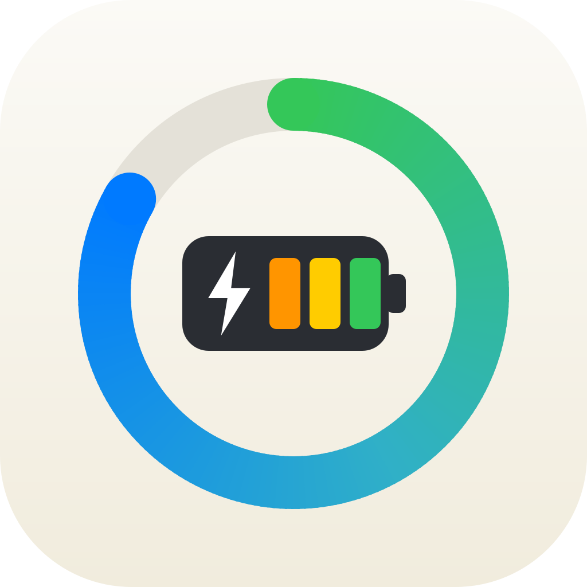

  

    <h2 class="section-heading text-uppercase">Our Apps</h2>
    <h3 class="section-subheading text-muted">Apps we design, build and run ourselves.</h3>
  

  

    

      
      <h3>5K QR Code</h3>
      
The complete parkrun companion

      
Show your parkrun barcode from your iPhone, Apple Watch or Garmin watch, track your journey with detailed analytics, and keep the whole family's profiles in one place. Private and works offline.

      
iPhone · iPad · Apple Watch · Garmin

      

        
        
      

      <a class="app-more" href="5kqrcode/">Find out more &rarr;</a>
    

  

  

    

      
      <h3>Voltsure</h3>
      
Private battery monitor for campervans and motorhomes

      
Turns your BM2 Bluetooth battery monitor into a clear view of your leisure and starter batteries, with low-voltage alerts and history that catches up. No account, no tracking, and your readings never leave your device.

      
iPhone · iPad · Mac · CarPlay

      

        <a class="btn btn-testflight" href="https://testflight.apple.com/join/MgdkBEQP">Join the TestFlight beta</a>
      

      <a class="app-more" href="voltsure/">Find out more &rarr;</a>
    

  

